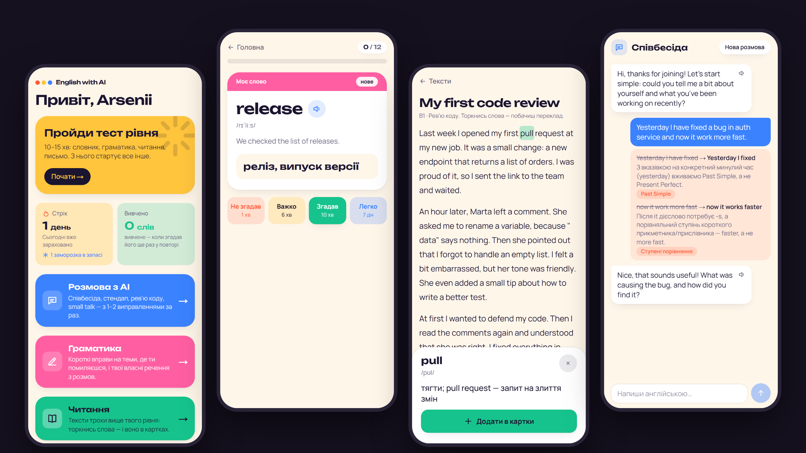
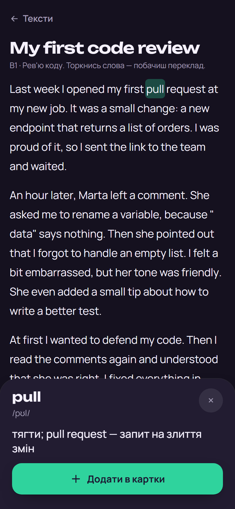
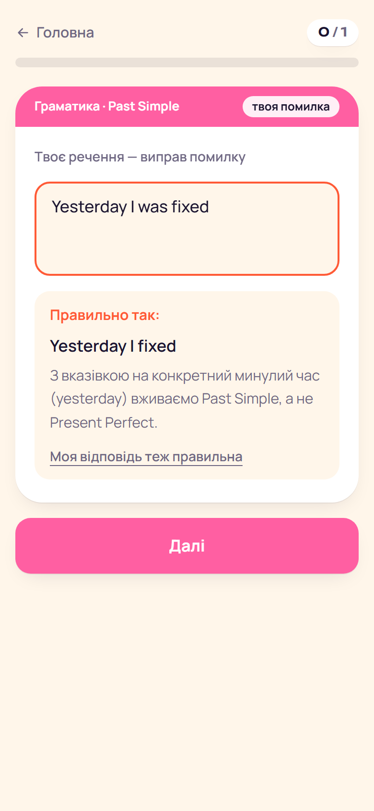

# English with AI

A Telegram Mini App I built to learn English myself. It measures your level first, then combines spaced repetition, AI conversation, grammar drills built from your own mistakes, and reading with tap-to-translate.



The interface is in Ukrainian, because that is who it is for. The content focuses on IT and everyday English.

## What it does

**Placement test.** Vocabulary size (a yes/no test with pseudowords to catch guessing), adaptive grammar, reading, and a writing sample that Claude assesses. The result sets where everything else starts.

**Flashcards with FSRS.** 679 words across everyday and IT topics, scheduled with the FSRS algorithm. Every review is logged, so the scheduler can be tuned on real data later. Add your own word from the app or by messaging the bot, and Claude completes the card.

**AI conversation.** Five scenarios, including a job interview, standup and code review. Claude replies in character and corrects at most two mistakes per message, so the conversation stays a conversation. Corrections feed the mistake log, and useful words become cards in one tap.

**Grammar from your own mistakes.** 420 exercises across 22 topics. Topics are prioritised by your test results and recent mistakes, and your own corrected sentences come back as exercises.

**Reading.** 12 graded texts about work and daily life. Tap a word for its translation and add it to your cards, keeping the sentence you found it in as the example.

| Reading in dark theme | Grammar drill |
|---|---|
|  |  |

## Engineering notes

- **The server does the scoring.** Test scores and answer checks run on the server from raw answers. The client never receives correct answers, and word IDs in the vocabulary test are hashes, so they can't reveal which words are fake.
- **Telegram login is verified.** Each request carries Telegram `initData`, checked by HMAC. Bot, database and Anthropic keys stay on the server.
- **AI output is treated as untrusted.** Claude responds through a JSON schema, and the parser drops any correction that quotes text the user didn't write. Conversation and own-word calls have daily limits per user.
- **AI is used only where it adds value at runtime.** Word sets, exercises and texts are generated once and stored as JSON files, with schema and coverage tests. Runtime calls are limited to conversation, the writing assessment and completing your own words.
- **Pure logic, tested.** FSRS sessions, placement scoring, drill selection and tokenising are plain functions in `src/lib`, covered by 189 Vitest tests.
- **Evidence-based by design.** Personalisation uses measured level, weak skills, goals and time, not "learning styles". There are no hearts, leagues or paywalls, and the streak is forgiving, with freezes.

## Stack

Next.js 15 (App Router) · TypeScript · Tailwind CSS 4 · Supabase (Postgres) · grammY · ts-fsrs · Claude API · Vitest

## Run it locally

You need Node 22+, a Supabase project, a Telegram bot token and an Anthropic API key.

```bash
npm ci
cp .env.example .env.local   # fill in the keys
```

Apply `supabase/migrations/` in order in the Supabase SQL Editor, then load the words and start the app:

```bash
node --env-file=.env.local scripts/seed-words.mjs
npm run dev
```

In development, opening the app outside Telegram signs you in as a test user, so use a separate Supabase project rather than one with real data.

```bash
npm test
```

## Project layout

```text
src/app/          pages and API routes
src/lib/          placement, srs, grammar, chat and reading logic
src/components/   shared UI
data/             word sets, grammar bank, reading texts and dictionary
supabase/         SQL migrations
scripts/          word generation and seeding
```

## Status

A personal project that I use myself and still develop. There is no public instance, and no licence is granted yet: the code is here to read.
